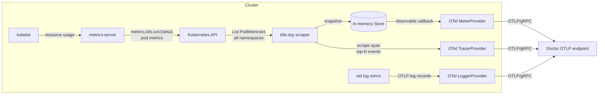

# k8s-top

`k8s-top` is a Kubernetes metrics exporter. It polls the Kubernetes metrics API
(`metrics.k8s.io`) for pod and container resource usage, keeps the latest snapshot,
and exports it over OTLP/gRPC as metrics, logs, and traces. Each pod/container sample
is annotated with Guardian partition, intent, and asset identity so the telemetry can
be attributed to the workload that produced it.

It is designed to run as a single, cluster-wide poller alongside an OTLP collector or
Doctor endpoint, with no local persistence and no Kubernetes write access.

## Architecture



The process is a loop with two independent cadences:

- **Poll interval** (`K8S_TOP_POLL_INTERVAL`, default `15s`): call
  `MetricsV1beta1().PodMetricses(NamespaceAll).List()`, aggregate container usage into
  pod totals, sort results by namespace/pod/container, and replace the in-memory
  snapshot. Each poll is a `k8s.top.scrape` trace span.
- **Metric interval** (`K8S_TOP_OTEL_METRIC_INTERVAL`, default `15s`): the OTel periodic
  reader invokes a callback that reads the latest snapshot and observes gauges. If no
  successful scrape has happened yet, no gauges are exported.

The scrape span carries `k8s.top.observed_namespaces`, `k8s.top.observed_pods`,
`k8s.top.observed_containers`, and `k8s.top.scrape.duration.seconds`. The busiest
containers by CPU and memory are added as `top-cpu-container` and `top-memory-container`
span events. Failures increment a counter and emit an OTLP error log.

## Metric instruments

All instruments use meter scope `k8s.top`.

| Name | Type | Unit | Description |
| --- | --- | --- | --- |
| `k8s.top.scrape.executions` | Int64Counter | - | Scrapes attempted |
| `k8s.top.scrape.failures` | Int64Counter | - | Scrapes that failed |
| `k8s.top.scrape.duration.seconds` | Float64Histogram | `s` | Scrape duration |
| `k8s.top.observed.pods` | Int64ObservableGauge | - | Pods in latest successful scrape |
| `k8s.top.observed.containers` | Int64ObservableGauge | - | Containers in latest successful scrape |
| `k8s.top.scrape.last_success_unix` | Int64ObservableGauge | `s` | Unix time of last success |
| `k8s.top.pod.cpu.usage.millicores` | Int64ObservableGauge | `m` | Pod CPU, summed over containers |
| `k8s.top.pod.memory.usage.bytes` | Int64ObservableGauge | `By` | Pod memory working set |
| `k8s.top.container.cpu.usage.millicores` | Int64ObservableGauge | `m` | Container CPU usage |
| `k8s.top.container.memory.usage.bytes` | Int64ObservableGauge | `By` | Container memory working set |

Counters and the histogram are recorded once per scrape. Gauges are observed from the
most recent successful snapshot.

### Metric attributes

| Attribute | Applies to | Source |
| --- | --- | --- |
| `k8s.cluster.name` | all instruments when configured | `K8S_TOP_CLUSTER_NAME` |
| `k8s.namespace.name` | pod and container gauges | metrics API |
| `k8s.pod.name` | pod and container gauges | metrics API |
| `k8s.container.name` | container gauges | metrics API |
| `guardian.target.partition` | pod and container gauges | pod label `guardian.partition` |
| `guardian.target.intent` | pod and container gauges | pod label `guardian.intent` |
| `guardian.target.asset` | pod and container gauges | pod label `guardian.asset` |
| `guardian.target.asset.type` | pod and container gauges | pod label `guardian.asset.type` (fallback `guardian.type`) |

### Resource attributes

The OTel `resource` is built from the environment and SDK defaults plus:

| Attribute | Value |
| --- | --- |
| `service.name` | configured service name |
| `service.version` | build version |
| `service.instance.id` | `HOSTNAME`, else binary name |
| `guardian.component` | binary name (`k8s-top`) |
| `k8s.cluster.name`, `guardian.cluster` | cluster name, when set |
| `vcs.revision` | build commit, when set |

`OTEL_RESOURCE_ATTRIBUTES` is honored, so additional resource-level identity labels
can be supplied by the deployment.

## Guardian identity resolution

Identity is read from the `labels` of each `PodMetrics` object returned by
`metrics.k8s.io` — that is, **pod labels, not annotations**. The values are copied onto
container and pod samples and emitted only when non-empty:

- `guardian.partition` → `guardian.target.partition`
- `guardian.intent` → `guardian.target.intent`
- `guardian.asset` → `guardian.target.asset`
- `guardian.asset.type`, or `guardian.type` if empty → `guardian.target.asset.type`

Pods without these labels still export usage metrics, just without Guardian target
attributes.

## Configuration

Configuration is environment-only; there are no flags or config files.

| Variable | Default | Purpose |
| --- | --- | --- |
| `OTEL_EXPORTER_OTLP_ENDPOINT`, `K8S_TOP_OTEL_ENDPOINT` | empty | OTLP/gRPC endpoint (`host:port`). Empty disables the OTLP pipeline. |
| `OTEL_EXPORTER_OTLP_INSECURE`, `K8S_TOP_OTEL_INSECURE` | `true` | Disable TLS to the OTLP endpoint. |
| `OTEL_SERVICE_NAME`, `K8S_TOP_OTEL_SERVICE_NAME` | `k8s-top.k8s-top.k8s-top` | `service.name` resource attribute. |
| `K8S_TOP_CLUSTER_NAME`, `KUBERNETES_CLUSTER_NAME` | empty | Cluster name attribute. |
| `K8S_TOP_POLL_INTERVAL` | `15s` | Kubernetes metrics polling cadence. |
| `K8S_TOP_OTEL_METRIC_INTERVAL` | `15s` | OTLP metric export cadence. |
| `K8S_TOP_KUBECONFIG` | empty | Explicit kubeconfig path; empty uses in-cluster config, then default kubeconfig. |
| `HOSTNAME` | binary name | `service.instance.id`. |

The component name and fallback instance ID come from the executable name. Durations
use Go syntax (`15s`, `1m`). The endpoint may include a scheme; it is reduced to
`host:port` for gRPC.

## Build and run

Container image (multi-stage, distroless runtime, statically linked binary):

```sh
docker build \
  --build-arg BUILD_VERSION=dev \
  --build-arg BUILD_COMMIT=$(git rev-parse --short HEAD) \
  --build-arg BUILD_TIME=$(date -u +%Y-%m-%dT%H:%M:%SZ) \
  -t k8s-top .
```

Local run against a kubeconfig, exporting to a local collector:

```sh
K8S_TOP_KUBECONFIG=$HOME/.kube/config \
K8S_TOP_OTEL_ENDPOINT=localhost:4317 \
K8S_TOP_OTEL_INSECURE=true \
K8S_TOP_CLUSTER_NAME=dev \
go run ./cmd/k8s-top
```

Build and test:

```sh
go build ./cmd/k8s-top
go test ./...
```

The process handles `SIGINT`/`SIGTERM`, stops polling, and flushes telemetry with a
five-second shutdown budget.

## Deployment notes

- **Workload**: a single-replica Deployment is sufficient. `k8s-top` is a stateless
  cluster-wide poller; replicas would duplicate all series. No leader election, service
  port, or persistent volume is required.
- **Metrics API**: the cluster must run metrics-server (or another provider of
  `metrics.k8s.io/v1beta1` pod metrics). Without it, every scrape fails.
- **RBAC**: read access to pod metrics cluster-wide. The scraper only lists
  `metrics.k8s.io` `pods` in all namespaces, so a ClusterRole with `get`/`list` on
  `metrics.k8s.io` `pods` bound to the workload ServiceAccount is sufficient. No access
  to core `v1` pods is needed; the metrics API object carries the pod labels.
- **Churn note**: the list call returns every pod in the cluster each poll; cost scales
  with pod count, not with the number of nodes.
- **Telemetry**: point `K8S_TOP_OTEL_ENDPOINT` at the OTLP/gRPC receiver (typically port
  `4317`) and set the cluster name so series from multiple clusters stay distinct.

## License

Apache License 2.0. See [LICENSE](LICENSE).
